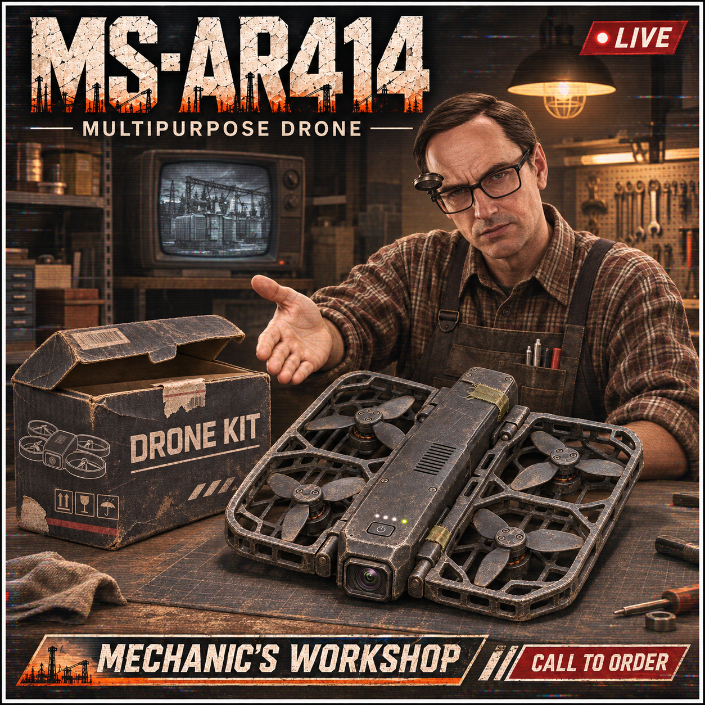

# Multipurpose Drone [Beta]

[Watch the flight demo](https://www.youtube.com/watch?v=F-koeMzecKk) · [HUD guide](docs/Multipurpose-Drone-HUD-Guide.png) · [Download the beta](../../releases/tag/v0.2.24)

Created by killdg with ChatGPT assistance. Standalone solo SPT 4.1.6 mod. No Raid Roulette or other gameplay mod dependency. Not co-op verified.

## Installation

Close the game and server. Copy the packaged BepInEx and SPT_Runtime folders into your SPT root. Both components are required. Restart the server and client. Existing settings and profiles are preserved.

## Kit workflow

Mechanic loyalty level 1 sells the MS-AR4144 Drone Kit for 65,000 roubles, with a base purchase limit of 50 per reset. Native account bonuses can increase the displayed limit.

1. Buy and unpack the kit using its context menu.
2. Bring the MS-AR4144 Drone, MS Glasses and MS-Remote into a PMC raid.
3. Equip the glasses. Place the remote in a special slot and bind it to a native quick-slot key.
4. Drop the drone on clear ground within four metres. Leave room above it for takeoff.
5. Press the remote key to deploy/connect. WASD and mouse steer; Q descends, E climbs. Your native sprint input requests 3x flight speed.
6. Press the same quick-slot key again to return to your PMC, or press F10 or remove the glasses to disconnect. The drone hovers and its battery continues draining. Press the bound remote key to reconnect.

Unpack uses the main stash outside raids, or the visible backpack, rig and pockets grids in raid. Secure containers and nested cases are excluded. All contents are checked for available space first. An interrupted transfer retains untransferred contents in the box; no replacement items are fabricated. The empty box is removed after its contents move.

## Repeatable F9 testing

Testing / Allow F9 test deployment defaults to enabled in this beta. With ordinary eyewear and an ordinary special-slot rangefinder, F9 deploys a synthetic drone without a purchase or dropped item. After destruction or battery expiry, F9 gives a fresh test aircraft with 100 HP and a ten-minute battery. F9 on an intact aircraft only toggles its feed. Test deployment consumes no inventory aircraft. Disable the option to test the strict kit workflow. The bound remote can launch another aircraft after destruction or expiry only when another real drone has been dropped nearby.

## Flight and combat

The operator remains physically present and vulnerable. No player teleport or immunity is applied. Flight has acceleration, inertia, braking correction, subtle piloted hover motion, physical map collision and a ground-clearance guard. The aircraft has 100 HP and a ten-minute deployment battery. Automatic landing/recovery and recharging are not implemented.

Contact with a living AI triggers a native RGN impact-grenade explosion carrying the operator's profile ID. Nearby bystanders and the operator can also be hurt. Native RGN damage is used, not a mortar-strength override. Kill credit still needs live confirmation.

AI engagement uses existing native firearms, aiming and ballistics with temporary point-target attention and distance-dependent error. No synthetic bullet damage or permanent enemy-list changes are introduced. Native brain behavior can still limit engagement.

## Camera, audio and visuals

- Native full-screen drone view with native color and field of view, telemetry, battery and HP.
- Fading full-body tracking outlines for visible moving people; map geometry blocks tracking.
- Signal shows four bars through 200 m, then three through 300 m, two through 350 m and one through 400 m. Static gets more frequent as the bars drop. Past 400 m the link can drop, and it always drops at 450 m. Move within 400 m and reconnect; the drone hovers and keeps using battery.
- Continuous user-supplied rotor loop with a live F1 volume slider (0–100%, default 25%). The middle audio segment uses a 200ms tail/head overlap and continues while disconnected. Destruction stops it; battery depletion plays shutdown audio.
- Generated inventory artwork for a worn opened kit and compact enclosed-rotor drone. Flight, inspection and dropped aircraft use our own procedural prototype geometry, including an approximate underbody payload. This is not a finished imported asset bundle. Glasses retain the native equipped model. The remote has a custom lens-free joystick icon and inspection model, while its native rangefinder hands animation is retained. The kit inspection preview shows the opened DRONE box.

## Airborne visibility changes in 0.2.9

Camera position refreshes before native dynamic-culling and adaptive-content jobs. Baked visibility samples walkable ground near the drone's horizontal position rather than invalid airborne cells. A bounded 20m NavMesh query runs at most five times per second. The real camera remains on the drone; the player is not moved.

Unity's ground-baked camera occlusion is temporarily disabled for the drone view and restored on disconnect. Frustum culling remains enabled. Existing native callbacks retain nearby content within 200m of the aircraft and 30m of the body, without whole-scene searches. This may increase draw calls. High-altitude and out-of-map viewpoints can still lack native content; the new behavior needs live verification.

## Settings and integration

### Target tracking with MS Glasses

Put the drone reticle over a tracked target and press **M** to mark it. Marking another target replaces the previous mark. Disconnect and keep the paired MS Glasses on to see the mark in your PMC view while the hovering drone can still see the target, even if a wall blocks your PMC's view.

Enable **Auto target tracking** under **Tracking** in F1 to relay all targets the hovering drone can see. It defaults to off. The overlay requires an active drone within radio range. You can rebind **Mark drone target** under **Shortcuts**.

Settings are in BepInEx/config/com.killdg.multipurposedrone.cfg. Optional Configuration Manager is not bundled. Defaults: enabled, MS Glasses viewing mode, 6 m/s, 450 m radio cutoff; the optional flight range limit is disabled by default, F9 test deployment, F10 disconnect.

The server reads only its shipped items.json and assort.json, registers four stable item templates before profiles load and adds one Mechanic offer. The client reads its own shipped icons/audio. Standard SPT trade and inventory operations are used. No custom network routes, telemetry, uploads, scheduled jobs, external processes or system-file changes are included.

Native hooks cover local controls, camera visibility, temporary AI aiming, custom icons/models, kit unpacking and the filled trader kit's purchase/appearance exceptions. Other containers retain normal restrictions. Pooled model renderer flags are restored on return. Camera, body/hands render state, audio and owned visuals are cleaned up at disconnect/raid teardown as applicable.

## Verification and build

Both projects compile with zero warnings/errors against local SPT 4.1.6 assemblies. Automated client checks cover health/battery/signal, F9 restart policy, native hook signatures and prior camera regressions. Native server checks verify item/offer deserialization, contents, loyalty, price, stock and registration phase. These are not live gameplay evidence.

Purchase/unpacking has been user tested; newer presentation, item-model, repeat-deployment and visibility repairs need continued testing. Provenance.json and SHA256SUMS.txt describe the local beta artifacts. This is not a tagged public release.

Run Package.ps1 with a local SPT path and adjust its SDK path for your build environment. Source packages exclude native game assemblies and decompiled reference code.

## 0.2.9 flight, presentation and replacement

The drone no longer adds a lens post-processing volume or replaces native camera FOV. Static and motion tracking remain. A new purchased aircraft can launch after the previous aircraft expires or is destroyed; each successful launch consumes only the selected dropped drone. AI that have fired at a nearby drone can attempt one short native navigation retreat per engagement before resuming aim, when a walkable route is available. All new behavior needs a live check.

## Kit pairing and aircraft loss

Unpacking records the three native item instance IDs in
`BepInEx/config/com.killdg.multipurposedrone.kit-pairs.txt` on this client. Use the
glasses and remote from the same kit. If the aircraft explodes, is shot down,
or runs out of battery, its own remote and glasses are dropped at the operator's
feet if still carried. Ordinary disconnects and F9 test aircraft do not drop gear.
Items unpacked before this update cannot be matched safely; unpack a fresh kit.

While connected, left-click to dive at a green-boxed AI. The drone prefers
the target under the reticle, otherwise the closest box to screen center.
An impact uses the existing player-attributed grenade. A dive into an obstacle detonates and plays Bad Work on return. Water volumes on the Water layer cause loss without detonation. F10 aborts; terrain
or loss of the target can also end a dive.

In 0.2.13, F9 can launch a replacement test aircraft after a crash without a
remote, glasses or a spare kit. Deploy from a spot with clear space ahead.
The drone uses your current game sprint binding and its press mode for boost.
Under Camera, Fisheye defaults to Off. Turning it on adds a mild barrel effect
through the native post-processing stack when available. This changes the lens
only. It does not replace the game's color grading or map streaming.

Unpacked kit parts show the same serial in the inventory count position. Serials
start at 0001 and are assigned per local installation. All three parts must
come from the same kit. Existing recorded pairs receive serials automatically.

Scroll in either direction to cycle Normal, Night Vision and Thermal. F6 is a direct night vision toggle. Night vision hides AI boxes. Thermal uses the native white-hot view. Right-click opens the framed zoom with a brief static fade and cycles Off, 10x, 20x, 30x, then Off. Shift-right-click closes it. Shift-F9 replaces an intact test drone with a fresh one when test deployment is enabled.

> is it realistic? not really, is it what they said might get included? who knows, just wanted to see what it would be like floating around a raid

### Upgrading from an earlier beta

With the game and server closed, remove the previous drone plugin and server mod folders before extracting this package. To carry over settings and kit pairings, copy the previous drone config and kit-pair registry to the new filenames documented above before launching. The item template IDs are unchanged.
